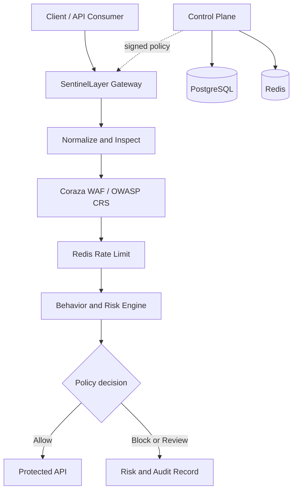

<div align="center">
  
  <h1>SentinelLayer</h1>
  <p><strong>API security gateway, risk-aware request enforcement, and auditable policy controls.</strong></p>
  <p>Platform keamanan API multi-tenant yang menghubungkan traffic gateway, WAF, rate limiting, risk engine, dan control plane.</p>
</div>

<p align="center">
  
</p>

## Fungsi produk

SentinelLayer berada di antara client dan API yang dilindungi. Setiap request melewati pemeriksaan teknis dan kebijakan sehingga tim keamanan dapat menentukan apakah traffic diteruskan, dibatasi, atau diblokir, sekaligus meninjau catatan keputusannya.

| Komponen | Fungsi | Hasil |
| --- | --- | --- |
| API gateway | Normalisasi request, inspeksi payload, dan proxy ke upstream | Traffic diproses melalui jalur enforcement yang terkontrol |
| WAF | Pemeriksaan dengan Coraza dan OWASP Core Rule Set | Temuan serta keputusan terhadap pola request berbahaya |
| Rate limiting | Pembatasan permintaan dengan state Redis | Pengendalian frekuensi request |
| Behavior & risk engine | Analisis pola frekuensi, urutan, korelasi, dan skor risiko | Keputusan risiko yang dapat ditinjau |
| Control plane | Manajemen tenant, RBAC, MFA gate, API key, sesi, dan policy | Pengaturan akses serta kebijakan keamanan |
| Signed policy | Versioning, approval, signature Ed25519, dan rollback verification | Distribusi policy yang dapat diverifikasi |
| Audit & operations | Audit event, metrics, retry/DLQ, dashboard, dan worker | Jejak aktivitas dan dukungan investigasi operasional |

## Alur perlindungan API

1. Client mengirim request ke SentinelLayer Gateway.
2. Gateway melakukan normalisasi, pemeriksaan payload, dan pemeriksaan WAF.
3. Rate limit dan behavior/risk engine mengevaluasi traffic.
4. Policy menentukan keputusan allow, block, atau review sesuai jalur yang didukung.
5. Request yang diizinkan diteruskan ke upstream. Keputusan dan event terkait dapat dicatat untuk audit.



## Arsitektur

- **Gateway:** Go, Coraza, OWASP CRS.
- **Control plane:** FastAPI, PostgreSQL, Alembic.
- **Shared runtime state:** Redis untuk pembatasan dan data operasional.
- **Policy integrity:** metadata bertanda tangan Ed25519, version floor, dan verifikasi rollback.
- **Operations:** dashboard, metrics, audit records, webhook retry/DLQ, dan maintenance worker.

Alamat gateway yang dikonfigurasi: [SentinelLayer di Railway](https://sentinelayer-production-635f.up.railway.app). Alamat layanan bukan jaminan ketersediaan atau sertifikasi keamanan.

## Menjalankan secara lokal

Lingkungan pengembangan menggunakan Python 3.11+, Node.js 22+, Go 1.26+, PostgreSQL, Redis, serta Docker untuk Compose.

```bash
git clone https://github.com/sentinelayer/sentinelayer.git
cd sentinelayer
cp .env.example .env
# Isi secret khusus lingkungan lokal
docker compose up --build
```

Untuk build dan test komponen:

```bash
python -m pip install -r requirements.txt
alembic -c alembic.ini upgrade head
npm --prefix dashboard ci --ignore-scripts --workspaces=false
npm --prefix dashboard run build
(cd gateway && go test ./... && go build ./...)
pytest -m "not integration" -q
```

## Konfigurasi keamanan

| Environment variable | Peran |
| --- | --- |
| `DATABASE_URL` | Koneksi data aplikasi sesuai role |
| `AUTH_DATABASE_URL` / `WORKER_DATABASE_URL` | Role autentikasi dan maintenance khusus |
| `REDIS_URL` / `REDIS_ADDR` | State dan rate limiting |
| `JWT_SECRET` | Penandatanganan sesi/token; minimal 32 byte |
| `METRICS_TOKEN` | Perlindungan endpoint metrics |
| `KMS_KEY` | Proteksi secret/material kriptografi |
| `SL_ENFORCE_PROVENANCE` | Pemeriksaan manifest dan digest source runtime |

Jangan gunakan secret development untuk deployment publik. Gunakan role PostgreSQL terpisah dan jalankan migrasi menggunakan kredensial khusus, bukan kredensial runtime. Binding hostname dan kunci policy harus disesuaikan dengan aplikasi upstream yang dilindungi.

## Dokumentasi

- [API and endpoints](docs/api.md) dan [OpenAPI control plane](docs/api/openapi-control-plane.yaml)
- [Arsitektur](docs/architecture/)
- [Gateway runtime policy](docs/operations/gateway-runtime-policy.md)
- [Multi-tenant hostname binding](docs/operations/gateway-policy-fleet.md)
- [Database roles](docs/operations/database-roles.md)
- [Deployment and recovery](docs/operations/railway-deployment.md)
- [Audit dan disaster recovery](docs/runbooks/dr-restore.md)
- [Production security criteria](docs/operations/production-readiness.md)

## Batasan klaim

Implementasi gateway, kontrol kebijakan, dan pengujian kode tidak dengan sendirinya membuktikan SLA, high availability, bebas false positive, atau hasil audit keamanan independen. Klaim tersebut harus didukung oleh pengukuran dan acceptance pada lingkungan yang benar-benar digunakan.
